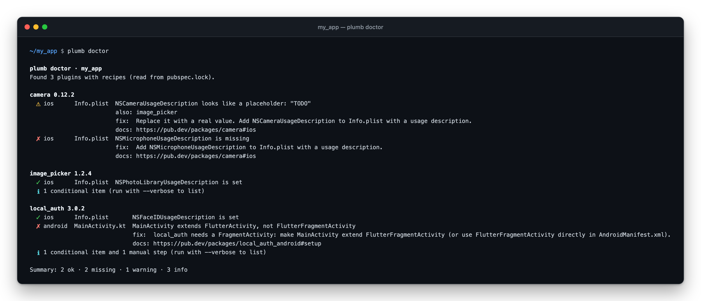

# plumb — native config for Flutter™

**Find the missing iOS and Android setup that your Flutter plugins need, before
it crashes your app or gets it rejected from the App Store.**



```sh
dart pub global activate plumb
cd my_flutter_app
plumb doctor
```

plumb only reads your project. It never changes a file.

If your terminal says `plumb` is not recognized or not found (common on
Windows), run `dart pub global run plumb doctor` instead, or see
[Install](#install).

## The problem

Adding a plugin like `camera` to `pubspec.yaml` is often only half the job.
Many plugins also need you to edit files inside your app's `ios/` and
`android/` folders, files most Flutter developers rarely open:

- **iOS:** add a sentence to `Info.plist` explaining *why* your app wants the
  camera, location or Face ID. Forget it and your app **crashes** the moment it
  asks for access. Leave it as `"TODO"` and App Review can **reject** your app.
- **Android:** add permissions to `AndroidManifest.xml`, or change which class
  your `MainActivity` extends. Forget it and the feature **quietly fails**.

These steps are spread across each plugin's README, they differ between
plugins and versions, and nothing warns you when one is missing. You usually
find out on a real device, or from an App Store email.

The native side of Flutter is a well-known pain point. In Flutter's
[Q2 2026 developer survey](https://flutter.dev/blog/flutter-q2-2026-survey)
(3,500+ responses), the largest theme among dissatisfied developers was
"Platform and ecosystem maturity" (44%), centered on upgrade pain. plumb starts
with one concrete piece of that: the native setup your plugins require.

## What plumb does

plumb is a checklist that runs itself:

1. It looks at which plugins your app uses, and which versions.
2. For each one it knows, it checks your iOS and Android files against what
   that plugin's **own documentation** says you must add.
3. It tells you, in plain words, what's missing, what still says "TODO", and
   exactly how to fix it, with a link to the docs it got that from.

Run it after adding a plugin, before a release, or in CI on every pull request.

**In numbers (v0.1.0):** checks 10 popular plugins · reads 5 kinds of files ·
takes about half a second · needs no Mac or Xcode · changes 0 files.

## Reading the report

**✗** must be fixed, **⚠** is there but still a placeholder,
**✓** is fine, and **ℹ** only matters if you use that feature (add `--verbose`
to see those).

## Where plumb is going

Today plumb **checks**. The long-term idea is that plugins could describe the
native setup they need in one small file, and a tool could apply it for you
safely, so nobody has to hand-edit Xcode or Android files again.

React Native developers already have this through
[Expo config plugins](https://docs.expo.dev/config-plugins/introduction/).
plumb aims to bring that idea to Flutter, starting with a read-only `doctor`
that tells you exactly what's missing, with a source link for every check.

None of that exists yet. v0.1.0 only reads and reports, so you can trust what
it tells you before trusting it to change anything.

---

# Details

The rest of this page is reference material.

## Install

```sh
dart pub global activate plumb
```

Requires Dart 3.8+ (Flutter 3.32+). Runs on macOS, Linux and Windows; Xcode is not needed.

**`plumb` is not recognized / command not found?** `dart pub global activate`
puts the `plumb` command in pub's cache folder, which is not on your `PATH` by
default. Pick one:

- Skip `PATH` and run it through Dart (works right away):
  `dart pub global run plumb doctor`
- Or add the folder to your `PATH`:
  - Windows: `%LOCALAPPDATA%\Pub\Cache\bin`
  - macOS / Linux: `$HOME/.pub-cache/bin`

  Programs read `PATH` when they start, so open a new terminal afterwards. If
  you use the terminal inside VS Code or Android Studio, quit the editor
  completely and reopen it; a new terminal tab is not enough. You don't need
  to restart your computer.
- Or add plumb to your app as a dev dependency (handy for teams and CI, since
  everyone gets the same version):

  ```sh
  flutter pub add --dev plumb
  dart run plumb doctor
  ```

## Usage

```sh
cd my_flutter_app
plumb doctor            # human-readable report
plumb doctor --strict   # exit 1 if anything is missing or a placeholder (for CI)
plumb doctor --json     # machine-readable report (for CI and AI agents)
plumb doctor --verbose  # also list conditional and manual items
plumb doctor path/to/app
```

plumb finds the app by walking up to the nearest `pubspec.yaml`, reads your
dependencies from `pubspec.lock` (or `.dart_tool/package_config.json`), and
applies the recipe for each plugin version it knows.

| Symbol | Meaning |
|---|---|
| ✓ | Present and valid |
| ✗ | Required and missing, or a file plumb couldn't read |
| ⚠ | Present but a placeholder (empty, `TODO`, `your … here`…), the wrong type, or only in some `.entitlements` files |
| ℹ | Only needed for some features, a manual step plumb can't check, or something it can't verify |

**Exit codes:** `0` done (with `--strict`: nothing missing or placeholder) ·
`1` `--strict` and something is missing or a placeholder · `2` the check is
incomplete (not a Flutter app, no `pubspec.lock`, unreadable native file) ·
`64` invalid command line. ℹ never fails a run.

### In CI

```yaml
# .github/workflows/native-config.yml
- uses: dart-lang/setup-dart@v1
- run: dart pub global activate plumb
- run: plumb doctor --strict
```

## What plumb checks

| File | What |
|---|---|
| `ios/Runner/Info.plist` (XML) | purpose strings and other keys, `UIBackgroundModes`; every `*UsageDescription` is checked for placeholder text, even without a recipe |
| `ios/Runner/*.entitlements` | entitlements such as `aps-environment`, in every `.entitlements` file |
| `ios/Runner.xcodeproj/project.pbxproj` | only to notice keys set as `INFOPLIST_KEY_*` build settings (reported as ℹ, never ✗) |
| `android/app/src/main/AndroidManifest.xml` | `<uses-permission>`, `<queries>`, `<meta-data>`, `<receiver>`/`<activity>`/`<service>` |
| `MainActivity.kt` / `.java` | the base class of your launcher activity |

### Supported plugins

Each recipe is written from the plugin's own documentation and links to it in
every finding. Versions outside the range are reported as ℹ "not checked".

| Plugin | Versions |
|---|---|
| [camera](https://pub.dev/packages/camera) | 0.9.0 – <0.13.0 |
| [firebase_messaging](https://pub.dev/packages/firebase_messaging) | 14.0.0 – <18.0.0 |
| [flutter_local_notifications](https://pub.dev/packages/flutter_local_notifications) | 19.0.0 – <23.0.0 |
| [geolocator](https://pub.dev/packages/geolocator) | 11.0.0 – <15.0.0 |
| [google_maps_flutter](https://pub.dev/packages/google_maps_flutter) | 2.0.0 – <3.0.0 |
| [image_picker](https://pub.dev/packages/image_picker) | 0.8.0 – <2.0.0 |
| [local_auth](https://pub.dev/packages/local_auth) | 2.0.0 – <4.0.0 |
| [permission_handler](https://pub.dev/packages/permission_handler) | 11.0.0 – <14.0.0 |
| [sign_in_with_apple](https://pub.dev/packages/sign_in_with_apple) | 5.0.0 – <9.0.0 |
| [url_launcher](https://pub.dev/packages/url_launcher) | 6.0.0 – <7.0.0 |

### What plumb does not check

Being clear about this matters more than looking complete:

- **Gradle, Podfile, Swift Package Manager, `AppDelegate`** — steps there (e.g.
  core library desugaring, Google Maps' iOS API key) are listed as ℹ manual steps.
- **Flavors** — only `ios/Runner/Info.plist` and the main `AndroidManifest.xml`
  are checked; other `Info*.plist` files and flavor manifests are listed as ℹ.
- **Merged manifests** — plumb reads your app's manifest, not the merged one.
  Recipes only list what a plugin's docs ask *you* to add.
- **Binary plists** (reported as ✗ with how to convert), localized
  `InfoPlist.strings`, macOS/web/desktop, Firebase config files.
- **Whether a purpose string is good enough for App Review** — plumb only flags
  empty and placeholder text.

## JSON output

`plumb doctor --json` prints a stable document (format `1`; changes are
additive) with no absolute paths or timestamps:

```json
{
  "format": 1,
  "plumb_version": "0.1.0",
  "project": { "name": "my_app", "dependency_source": "pubspec.lock" },
  "packages": [
    { "name": "image_picker", "version": "1.2.4", "status": "checked", "recipe": "recipes/image_picker.yaml" }
  ],
  "findings": [
    {
      "id": "image_picker/ios/info_plist/NSPhotoLibraryUsageDescription",
      "severity": "missing",
      "package": "image_picker",
      "platform": "ios",
      "file": "ios/Runner/Info.plist",
      "key": "NSPhotoLibraryUsageDescription",
      "message": "NSPhotoLibraryUsageDescription is missing",
      "fix": "Add NSPhotoLibraryUsageDescription to Info.plist describing why your app needs the photo library. App Store policy requires it even if you always pass requestFullMetadata: false.",
      "source": "https://pub.dev/packages/image_picker#ios",
      "also_needed_by": []
    }
  ],
  "summary": { "error": 0, "missing": 1, "warning": 0, "ok": 0, "info": 0 }
}
```

Finding `id`s are stable, so CI scripts can match on them. Setup errors are
JSON too: `{"format": 1, "plumb_version": "0.1.0", "error": "…"}`.

## Recipes

A recipe is a small YAML file describing what one plugin needs
([`recipes/`](https://github.com/UmeshRaj7/plumb/tree/main/recipes),
[JSON Schema](https://github.com/UmeshRaj7/plumb/blob/main/schema/recipe.schema.json)):

```yaml
schema: 1
package: image_picker
versions: ">=0.8.0 <2.0.0"
source: https://pub.dev/packages/image_picker#ios
ios:
  info_plist:
    NSPhotoLibraryUsageDescription: { required: true, hint: "Describe why your app needs the photo library." }
    NSMicrophoneUsageDescription: { required: when_used, hint: "Needed if you record videos." }
```

Missing a plugin? See [CONTRIBUTING.md](https://github.com/UmeshRaj7/plumb/blob/main/CONTRIBUTING.md#writing-a-recipe):
recipes must come from the plugin's own docs and cite them.

---

Flutter and the related logo are trademarks of Google LLC. plumb is not
affiliated with or endorsed by Google.

Licensed under the [MIT License](LICENSE).
